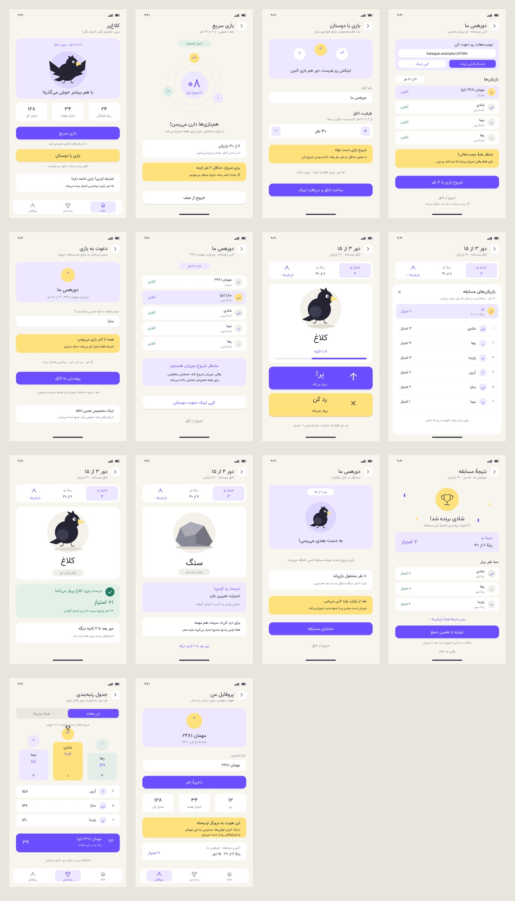

# Kalaqpar — Module Development Guide

> Product rules remain authoritative. The integrated implementation, exact commands, deployment examples, verification evidence and limitations are documented in [OPERATIONS.md](OPERATIONS.md). Persian handoff: [README.fa.md](README.fa.md). Read this entire specification and every supplied design before changing the interface.
>
> **Owner override (2026-10-22): do not author or modify frontend/backend tests, test helpers, fixtures, scripts, frameworks, dependencies or testing CI for this task. Existing testing files must remain untouched. This overrides every earlier test-authoring requirement below. Only normal syntax/lint/build commands and direct manual verification are authorized; behavioral/security/concurrency acceptance requirements still apply.**

## 1. Purpose and Scope

Build a real multiplayer reaction game: during each round, every participant in a match sees **the same item's image and name** and chooses one of two buttons: **«پر!» (Fly!)** or **«رد کن» (Skip)**. The server processes answers and scores.

This is **not a word-guessing game, crossword, multiple-choice quiz, turn-based game, or browser-only multiplayer simulation**. There is no text-answer input. “Skip” is an answer; it does not advance the image for an individual player.

- Technical module name: `Kalaqpar`.
- Required path, relative to the project root: `src/Modules/Kalaqpar`.
- Root PHP namespace: `Src\Modules\Kalaqpar`.
- Current display name: Kalaqpar.
- Product interface: Persian, RTL, responsive, and mobile-first. This English documentation does not require an English interface.
- Two entry paths: **Quick Play through a public queue** and **Play with Friends through an invitation-only room**.
- Match capacity: **2–30 players**; **15 rounds** by default; no elimination for mistakes.

### Precedence and Superseded Rules

The final rules in this document supersede conflicting earlier specifications: elimination for mistakes, “do nothing” as an answer, a default 30-round limit, a fixed six-player capacity, last-survivor victory, and an elimination screen are no longer valid.

Repository instructions and project conventions govern implementation; this specification governs game behavior and security guarantees. The design reference governs visual design; its sample numbers, names, and results are not real data or independent rules. Where an image conflicts with a rule, this specification takes precedence. Report genuine incompatibilities; do not silently change the stack or weaken security. Keep the Persian and English versions synchronized.

## 2. Required Stack and Project Integration

| Area | Requirement |
|---|---|
| Backend | PHP 8.2+, or the higher minimum required by installed dependencies |
| Framework | Pano only; skeleton: https://github.com/pano-php/pano ; library: https://github.com/pano-php/framework |
| Database | SQLite through PDO |
| Frontend | HTML, Bootstrap 5 RTL, CSS, vanilla JavaScript, and Fetch API |
| Live communication | HTTP/JSON and short polling |
| Game progression | Shared hosting: authenticated short POST progression (default). Optional persistent Pano CLI worker with `KQ_PROGRESSION=worker`. |

Do not use React, Vue, Angular, jQuery, another backend framework, an independent router, WebSocket, or SSE in version one. Do not add Redis, MySQL, mandatory external services, or a Node.js runtime dependency. Prefer local essential assets, fonts, and Bootstrap; basic gameplay must not depend on a CDN.

### Before Writing Code

1. Inspect `AGENTS.md`, repository instructions, Git status, and existing user changes.
2. Read `composer.json`, `composer.lock`, autoload mappings, the installed Pano version, bootstrap, and module registration.
3. Inspect existing modules and real examples of routes/handlers, DI, interceptors/middleware, validation, templates, assets, migrations, seeds, CLI, logging, and tests.
4. Do not invent Pano APIs or commands. Use installed code and documentation matching that version, not merely the layout of an online example repository.
5. Actually open and inspect `src/Modules/Kalaqpar/Files/Desings/00-overview.jpg`.
6. State a brief integration plan, module registration points, and necessary changes outside the module, then proceed with implementation.

### Module Boundaries

- Keep game-specific code and resources inside `src/Modules/Kalaqpar` wherever project conventions allow. Extend the existing module; do not create a parallel implementation.
- Place game PHP classes under `Src\Modules\Kalaqpar` and its subnamespaces. Migration exceptions must follow host tooling.
- Derive directory names, layers, templates, and service registration from the actual project. This document does not impose a fictional directory tree.
- Put rules in testable services, not templates, routes, or the worker loop. Make the clock and randomness source injectable.
- Do not create a separate bootstrap, public entry point, `vendor` directory, Composer project, or migration engine. Do not overwrite root files or upgrade dependencies unnecessarily.
- If the host requires centralized migrations, tests, or assets, make only the necessary, limited integration changes and document their paths and reasons.
- Naming defaults, where compatible: routes under `/kalaqpar`, route/config names prefixed with `kalaqpar`, CLI commands with `kalaqpar:`, and tables with `kalaqpar_`.
- Do not change the behavior of other modules' authentication, layouts, cookies, or databases. If needed, add a dedicated SQLite connection through host configuration and DI.
- Scope CSS and JavaScript to the Kalaqpar interface root. Do not introduce conflicting Bootstrap versions or disruptive global handlers.

## 3. Design Reference and Screens

The authoritative visual reference is:

```text
src/Modules/Kalaqpar/Files/Desings/00-overview.jpg
```

The spelling **`Desings`** matches the existing path and is intentional here. Do not rename it to `Designs`.

Place this README and its Persian counterpart in the module root so the following image resolves correctly:



Visual language: a warm, light background; rounded white cards; purple primary actions; yellow secondary actions and invitations; lavender surfaces; cheerful, simple illustrations; readable Persian typography; and comfortable mobile spacing. An unstyled Bootstrap page or a static screenshot instead of a working interface is not acceptable.

The following names identify the generated designs. Separate files may not exist in the repository; the designated reference is the overview. Inspect individual designs as well if available.

| Design | Required behavior |
|---|---|
| `01-home` | Real identity and statistics, short rules, “Quick Play” and “Play with Friends” CTAs, profile and leaderboard access |
| `02-public-queue` | Player count, capacity, server-based waiting time/countdown, leave queue |
| `03-create-room` | Room name, capacity selection from 2 to 30, manual-start explanation, creation and invitation link |
| `04-host-lobby` | Copy/share link, player list and presence, count, host-only start |
| `05-join-invitation` | Limited room preview, guest name, capacity and join; full/closed/started states |
| `05b-guest-lobby` | Player list, copy link, wait for host, leave; no start permission |
| `06-live-game` | Large image and item name, round out of 15, timer, own score/rank, two large buttons |
| `07-player-list` | Scrollable panel/screen containing all players, ranks, scores, and presence |
| `08-round-feedback` | After the round ends: correctness, score change, and waiting for the next round |
| `08b-skip-feedback` | Clearly explain “Your skip was correct, but only the first correct answer earned the speed point”; show zero points |
| `09-next-match-waiting` | Late invitee, waiting for the next match, authorized spectating without answering |
| `10-match-results` | Winner or joint winners, own rank/score, all results, play again |
| `11-leaderboard` | Weekly/all-time views, pagination, own position even outside the current page |
| `12-profile` | Name/avatar, name editing, statistics, history, guest identity persistence warning |

### User Experience Requirements

- Do not place 30 names at the top of the game. Show the player's own score/rank, a top-three summary, and an “All players — N” button.
- Use a purple «پر!» button and a yellow «رد کن» button, both large and touch-friendly. “Skip” is not a small link or a next-stage button.
- Upon selection, lock both buttons and show a submitting state. After acknowledgement, show only “Answer recorded.” Hide correctness until the round ends.
- On network failure, retry the same selection and `request_id`. Do not permit a contradictory choice while acceptance is uncertain. Refresh must restore server state.
- Design loading, empty, pending, offline, reconnecting, late-answer, full/closed room, invalid invitation, host-change, and unavailable-worker states.
- Animate the countdown smoothly, but the browser timer is not authoritative. Do not publish the current round's score/rank changes before settlement.
- Support touch, mouse, and keyboard: Space for Fly and ArrowDown for Skip. Ignore game shortcuts when focus is in input/textarea/contenteditable, and ignore key repeat. Touch and click must not submit twice.
- Use touch targets of at least 44px, visible focus, labeled buttons, image alt text without answer disclosure, sufficient contrast, and `prefers-reduced-motion`. Do not communicate status through color alone.
- Verify Persian typography, spacing, RTL ordering, Persian numeral display, and mobile-to-desktop responsiveness. API timestamps and numeric data must remain standard numeric values.
- Provide bottom navigation for home/leaderboard/profile where appropriate. Explain the consequences before leaving an active game.

## 4. Final Rules and Scoring

Classification is based on **ordinary ability to fly**, not simply being a bird. Crows and butterflies fly; cats, stones, penguins, and ostriches do not. Exclude ambiguous, fictional, vehicle-related, and condition-dependent cases in version one.

| Item type | Answer within the valid window | Score |
|---|---|---:|
| Flying | Fly | `+1` for every correct player |
| Flying | Skip | `-1` |
| Non-flying | First correct Skip | `+1` for exactly one player |
| Non-flying | Other correct Skips | `0`, but counted as correct in statistics |
| Non-flying | Fly | `-1` |
| Either | No valid answer by the deadline | `-1` |

- Mistakes and timeouts never eliminate players. All participants remain on the match roster until it ends.
- Each player has at most one accepted answer per round. The first accepted answer is final and cannot be changed.
- An accepted but incorrect answer receives `-1` exactly once; do not subsequently apply another timeout penalty.
- Duplicate, rejected, or late requests have no independent penalty. If no valid answer exists, apply the round's ordinary timeout once.
- The first correct Skip does not end the round. In version one, keep the fixed deadline even if everyone has answered; do not reveal results early.
- After settling every player in the final round, the highest **score in that match**, not the account's all-time score, wins.
- Negative scores are allowed. If all scores are negative, the highest still wins. Ties for the highest score produce **joint winners**, including when everyone ties.
- Record one win for each joint winner. Winning grants no additional score bonus. Record each result/win only once.
- Snapshot the round count and settings at match start. Configuration changes must not alter an active match.

## 5. Timing, Fairness, and the Meaning of “First”

### Configurable Defaults

These are version-one implementation decisions for otherwise open details. Sample values in the designs do not override them.

| Setting | Default |
|---|---:|
| Round count | 15 |
| Initial countdown | 3 seconds |
| Answer window | 2500ms for rounds 1–5, 2300ms for 6–10, 2100ms for 11–15 |
| Window reduction | 200ms every 5 rounds; floor of 1500ms |
| Inter-round feedback interval | 2000ms; next-round countdown occurs within this interval |
| Public capacity | 30; minimum start count of 2 |
| Private capacity | Host selects 2–30; default 30 |
| Public formation wait after second player | At most 12 seconds, followed by the initial countdown |
| Worker tick | Approximately 100ms |
| Active-game polling | Approximately 300ms |
| Queue/lobby polling | Approximately 1000ms |
| Offline threshold | 15 seconds without a valid heartbeat |
| Host transfer after disconnection | 30 seconds without heartbeat; immediate on explicit departure |
| Long worker outage threshold | 10 seconds; configurable |
| Completely empty room expiry | 30 minutes |
| Default guest identity lifetime | 180 days |

For one-based round number `n`, the answer window is `max(1500, 2500 - 200 * floor((n - 1) / 5))` milliseconds.

### Authoritative Version-One Policy

- The server is authoritative for start times, deadlines, acceptance, ordering, and scoring. Everyone shares the same `round_id` and schedule.
- Acceptance interval: `starts_at <= server_accepted_at < deadline_at`. An answer at the exact deadline is late. Never reopen a settled round.
- Capture `server_accepted_at` from the server clock inside the atomic acceptance operation, after acquiring the write lock and before inserting the answer. Do not capture it before waiting for the lock and subsequently accept an expired answer.
- “First” means earliest valid server acceptance order in that round. A unique server-side sequence resolves simultaneous/equal timestamps deterministically. Exactly one player earns the speed point.
- Requests may carry `client_elapsed_ms` based on `performance.now()`, a client timestamp, and a synchronization sample identifier. The client should submit elapsed reaction time, but this is **untrusted**, auxiliary/diagnostic data; it does not determine scoring, deadlines, or ordering.
- Estimate RTT and clock offset using several server-time samples. Use these estimates for timer display and connection diagnostics. Flag or discard negative, invalid, or implausible telemetry; never allow it to rewrite the past.
- Version one has **no late-answer grace period and no ordering based on raw browser timestamps**. Competitive latency compensation requires a documented policy, a bounded allowance, a separately authorized anti-cheat evaluation, and synchronized updates to both READMEs.
- The next round's start time may be announced in advance, but its item identity and answer must not be disclosed. Preload/cache the public image library, not a “next round → image” mapping. Reveal the active item only at the permitted start.
- The server selects images. Filenames, URLs, and metadata must not disclose `can_fly` or the answer category. Publish correctness only after the deadline.
- Polling, network delay, and lock acquisition can create timing advantages. This policy is measurable and safer than trusting browser clocks, but it does not guarantee network equality or prove the actual touch time. State this limitation honestly in the short game instructions too.

## 6. Automatic Guest Identity

- No email, phone number, password, or registration form. First entry creates a persistent guest identity, a default Persian name, and an avatar/color.
- Generate a cryptographically secure token with at least 256 bits of entropy. Store only its hash in the database. Store the original in a module-specific cookie with `HttpOnly`, `SameSite=Lax`, and `Secure` on production HTTPS.
- Default lifetime is 180 days with controlled renewal. Do not store the token in localStorage, URLs, or logs. A client-provided user identifier is not authentication.
- Refresh, multiple tabs, and returning with a valid cookie must restore the same identity. Coordinate concurrent bootstrap requests to avoid unnecessarily creating multiple guests.
- Allow editing the display name; uniqueness is not required. Default length: 2–30 visible characters. Reject/sanitize control characters and malicious input. Use a separate public identifier independent of the name.
- Show this profile warning in Persian: «با پاک‌کردن کوکی‌ها یا تغییر مرورگر، دسترسی به این پروفایل از بین می‌رود.» (“Clearing cookies or switching browsers will lose access to this profile.”)
- Visiting the site creates identity only; joining a queue/room requires an explicit action. Preserve the host application's login and cookies.

## 7. Public Queue and Friends' Rooms

### Quick Play

- Use a real FIFO queue without bots or fake players. One player waits; arrival of the second starts a formation window of at most 12 seconds.
- At capacity or when the window expires, if at least two players are present, freeze the roster and begin the three-second start countdown.
- If presence drops below two before the match begins, cancel the countdown and return to waiting. Start a fresh formation window when the minimum count is reached again.
- Join/leave operations must be idempotent. Refresh must not reset queue position. Remove offline users from the queue after 15 seconds.
- Do not mix public and private rooms. Enforce capacity transactionally.

### Invitation-Only Rooms

- The host chooses a name and capacity from 2 to 30 and becomes the first member. Validate room names with a default maximum of 40 characters.
- Invitations use a server-generated random six-digit code (100000–999999), shared by manual entry and `/join/[code]` URLs. This owner override replaces the earlier long invitation token requirement, not the 256-bit guest authentication token. Private rooms have no public listing and are never filled from the public queue. See section 16 for allocation, rate limits and compatibility.
- Link holders may see a limited preview of name/capacity/status. Full membership lists and match state require membership/spectator authorization.
- Opening a link with GET must not automatically join. The Join button uses POST and checks identity, capacity, and phase. Possessing the invitation does not grant host privileges.
- Provide separate «کپی کد», «کپی لینک» and «اشتراک‌گذاری» actions. Shared Persian text contains both the readable code and the configured absolute URL. Use Web Share with copy/manual-selection fallbacks and truthful feedback; cancellation is not an error. Keep invitations out of analytics/logs and prevent external leakage with a no-referrer policy.
- **Only the host** may start, with at least two present members. A full private room does not auto-start. Recheck authorization, capacity, presence, and phase inside the transaction.
- Freeze the participant roster when the countdown begins. New arrivals wait for the next match. If the countdown is canceled, the lobby becomes joinable again.
- Explicit host departure: transfer immediately to the longest-standing present member. Disconnection: after 30 seconds, transfer atomically to the longest-standing present member. There must be only one host; a returning former host does not reclaim ownership automatically.
- If nobody is present, starting is impossible; the first eligible member to become present can become host. Close empty rooms after their TTL, but do not treat an active match as empty merely because players are offline.
- Once started, a match must not depend on the host remaining online. The host cannot control answers, scores, or early completion.

### Late Invitations, Spectating, and Rematches

- Never add a new participant to an active match. A valid invitation may authorize waiting/spectating in that room, not answering in the current match.
- Display waiting, spectator, and participant counts separately. In version one, cap the next-match waiting list at the room's capacity; additional arrivals receive a “waiting list full” message.
- Spectators see only permitted public round information. Other players' answers, correctness, current-round score changes, and speed results remain hidden until the round ends.
- After a private match, “Play again with this group” means opting into the next match/returning to the lobby, not automatically starting. Returning previous participants have priority; then admit waiting users in arrival order up to capacity. Others keep waiting. The host starts manually again.
- Every new match receives a new identifier and starts with zero match points. Preserve history and all-time scores. The room link remains valid until the room closes.
- After a public match, “Quick Play again” enters a fresh public queue. Preserving a public group is not required in version one.

### Membership, Leaving, and Disconnections

- Each identity may have at most one active engagement: a queue, a lobby/waiting state in one room, or participation in one match. Preserve historical membership separately. Switch paths through explicit/atomic departure, not hidden concurrent memberships.
- A brief disconnection must not eliminate players or alter the match roster. Reconnection restores the same match and accepted answer.
- Offline participants remain part of the match. Each unanswered round receives the normal `-1`, not an additional disconnection penalty. Calculate accuracy and score accordingly.
- Confirm manual departure from the game/page with a warning: scoring participation continues until the match ends, and unanswered rounds receive `-1`. Leaving is not an escape from penalties and does not release the lock against joining another match. Returning to this match is allowed.
- Do not declare an early winner because players went offline. Continue the configured number of rounds unless a server failure causes technical cancellation.
- Multiple tabs share one identity and one answer per round. Enforce all restrictions server-side.

## 8. Server Execution and API Contract

### State Lifecycle

Conceptual match lifecycle:

```text
countdown → round_active → round_feedback → ... → finished
                    ↘ technical_cancelled
```

Lobby/queue, next-match waiting, presence, and spectating are states separate from match participation. The implementation makes transitions and permissions explicit; verify them manually where the environment permits.

- Shared hosting (owner override, 2026-10-22): authenticated, CSRF-protected POST heartbeats drive the existing server engine. A common filesystem lock serializes progression, and SQLite transactions enforce game rules. No persistent process or recurring cron job is required. GET requests remain read-only. In optional worker mode, a single worker registered through the host CLI advances games independently of player polling.
- Require a real progression lock, persisted successful-pass heartbeat, structured logs and recovery. Worker mode also requires graceful shutdown. Shared mode stops making transitions when no authenticated requests arrive; the next POST applies the same ten-second technical cancellation rule before advancing stale games.
- Recover short interruptions using persistent state and idempotent operations. After an outage exceeding the threshold, technically cancel stale matches: do not mass-penalize the open round, preserve settled scores, award no wins, and do not count a completed competitive result. Explain the reason in the UI.
- In worker mode, stopped/stale workers reject starts and answers. Shared mode reports seeded-content readiness rather than daemon liveness; failed progression and maintenance return safe service errors. Both modes preserve accepted answers and enforce server deadlines.
- Allow at most one in-flight poll per page. Use backoff and jitter on errors, reduce polling outside gameplay, and throttle heartbeat writes. Older responses with a lower `state_version` must not overwrite newer UI state.
- Keep `state_version` monotonically increasing within its room/match scope. Discard responses for a previous identifier after navigation.

### Conceptual Endpoints

Register actual paths according to the host Pano application. This list is not framework syntax:

- Bootstrap/me, profile read/update.
- Queue join/leave/state.
- Room creation, invitation preview, join/leave, lobby state, host start.
- Next-match waiting, spectator authorization, rematch readiness.
- Match state, answer, confirmation of leaving the match view, results/history.
- Leaderboard with period and pagination; health exposing minimal, non-sensitive information.

Use GET for reads. Join, leave, start, create, answer, rematch, and update operations require state-changing methods and CSRF protection. Create identities through a secure POST bootstrap or a compatible existing mechanism. Read endpoints must not accidentally enroll users in games.

Authorized state should include `server_now`, `room_id`, `match_id`, `state_version`, `phase`, `round_id`/round number, total rounds, `starts_at`, `deadline_at`, next transition time, the user's role/permissions, player presence, settled scores, and the user's own answer-submission status. Expose the active item's name and image only when permitted. Use UTC timestamps with a consistent, documented unit, preferably epoch milliseconds.

Answer request:

```json
{
  "match_id": "...",
  "round_id": "...",
  "action": "fly",
  "request_id": "...",
  "client_elapsed_ms": 742
}
```

Allow only `fly` or `skip` for `action`. Derive identity from the authenticated cookie. Never trust submitted scores, ranks, correctness, or `user_id`. Keep `request_id` unchanged for retries of the same operation; reusing it with a different payload must produce a conflict. A response uniqueness constraint must also prevent a second answer using a new request identifier.

A successful submission acknowledges acceptance and locks the choice only. Neither the answer response nor state responses may disclose correctness, score changes, or the speed winner before the round ends. Use consistent JSON errors with machine-readable codes, safe messages, and appropriate HTTP statuses. Return personal/game responses with `Cache-Control: no-store`.

## 9. SQLite, Scoring, and Concurrency

- Store SQLite on local disk outside the public directory. Use PDO and prepared statements. Enable `foreign_keys=ON` for every connection, WAL, and a suitable `busy_timeout`.
- Keep transactions short. Use `BEGIN IMMEDIATE` or a correct equivalent for critical writes, with bounded `SQLITE_BUSY` retries. Do not hold transactions open during sleeps or network I/O.
- Capacity allocation, host ownership, answer acceptance, and settlement must be atomic. The worker and answer handler must use consistent time boundaries and locking.
- Conceptual tables: module-specific guests/users, auth_tokens, items, queue_entries, rooms, room_members, matches, match_players, rounds, round_responses, score_events, match_results, and worker_status. Adapt names/decomposition to the project. A room is not a match because rooms support rematches.
- Use versioned migrations, foreign keys, and appropriate indexes. Require uniqueness for responses `(round_id, player_id)`, rounds `(match_id, number)`, results `(match_id, player_id)`, and logical settlement events. Preserve cross-table active-membership invariants through atomic operations and appropriate constraints.
- `score_events` is an immutable score ledger: player, match, round, delta, reason, timestamp, and unique key. Zero-point settlements may be events too. Every player/round must have one definitive settlement outcome.
- Insert the event and update match/all-time scores in the same transaction. Retries, crashes, and repeated worker execution must not duplicate effects. Wins and result statistics must also be idempotent.
- Provide a CLI command to rebuild cached scores from the ledger. Physically deleting a room/identity must not accidentally cascade-delete score history.
- Keep the database, WAL/SHM files, backups, tokens, and logs inaccessible from the web. Use isolated private storage when manually evaluating a deployment.

## 10. Rankings, Statistics, and Content

### Scores and Rankings

- Version-one default: public and private matches use the same rules and both contribute to all-time/weekly scores. Store the mode for future reporting/filtering. This decision does not guarantee resistance to collusion or multiple identities.
- Match rank uses that match's score. All-time rank uses the full ledger total. Weekly rank uses events within that week.
- The week starts Saturday at 00:00 in `Asia/Tehran`, converted correctly to UTC. Store UTC timestamps and query half-open intervals. Do not reset scores through a cron job.
- Equal scores receive shared competition ranks (1, 1, 3). Use public player identifiers for stable ordering within ties, without breaking joint victory. Include pagination and the current user's position.
- Exclude identities with no settled rounds from competitive leaderboards. Count wins/completed matches only for `finished` matches. Show canceled matches separately in history; retain scores settled before cancellation.
- Accuracy is correct selections (correct `fly` and all correct `skip` answers, including zero-point ones) divided by the player's valid settled rounds. Mistakes and timeouts count as incorrect. Exclude server-invalidated rounds and spectator-only states from the denominator. Display “—” when the denominator is zero.
- Profile fields: name/avatar, all-time and weekly scores, completed matches, wins including joint wins, best completed-match score, accuracy, join date, and recent history. Remove “survival” metrics.

### Items and Images

- Provide at least 100 unique, reviewed Persian items, including at least 30 real flying items. Each needs a relevant image/illustration, name, and private server-side answer category.
- Show a stone for a stone and a crow for a crow. Do not reuse one generic image or unrelated emoji for everything. Document asset sources and usage rights.
- Keep selection approximately balanced between categories without predictable alternation. Do not repeat an item from the previous five rounds of that match. Make seeding rerunnable and keep the randomness source injectable; do not author test code.
- Do not expose `can_fly` or answer explanations before round end through JSON, HTML, data attributes, JavaScript bundles, or asset names. A public image catalog is allowed; future order and classification labels are not public.
- Handle failed image loading with the item's text name and a suitable fallback. Images and names should complement each other for accessibility.

## 11. Security

- Authenticate guests and check membership/roles on every operation. Changing `room_id`/`match_id` must not grant access to another room. Spectators cannot answer; lobby guests cannot start.
- Protect state-changing operations against CSRF, validate Origin where appropriate, default to same-origin, and do not enable unrestricted CORS.
- Apply separate rate limits to identity/room creation, invitation guessing, joining, answers, and name updates. Do not unnecessarily block legitimate polling or users behind NAT. Limit request body sizes and pagination.
- Escape names or use `textContent`, not unsafe `innerHTML`. Require Unicode validation, prepared statements, and safe asset URLs.
- Production errors must not expose stack traces, internal paths, or secrets. Logs must omit tokens/cookies/full invitation links. Minimize metrics and avoid unnecessary personal data collection.
- If PHP sessions are used, release session locks early so polling and answer requests do not block one another.
- Do not claim complete prevention of bots, multiple identities, invitation sharing, collusion, or network-speed advantages.

## 12. Manual Acceptance Criteria and No-Test-Authoring Decision

The owner explicitly excludes test authoring and automated acceptance coverage. Do not create or modify test code, fixtures, helpers, scripts, frameworks, dependencies, runners or testing CI. Keep existing tests untouched. Injectable clock/randomness remain architectural features. The following are behavioral acceptance criteria for code review and direct manual review; an unchecked box is not evidence of successful execution. See OPERATIONS.md for checks actually performed and limits.

- [ ] Automatic identity, secure cookies, refresh, multiple tabs, name editing, and no interference with host login.
- [ ] FIFO queue, single-player waiting, two-player start after formation wait, early start at 30, count dropping during countdown, leaving, and reconnecting.
- [ ] Room capacities of 2 and 30; reject 1/31; capacity under concurrent joins; invalid/closed invitations; no public-queue entry into private rooms.
- [ ] Host-only start, duplicate start, start/join/leave races, host transfer, and uninterrupted matches after host disconnection.
- [ ] Late invitations, spectating without answering or answer leakage, waiting, and rematches with new identifiers.
- [ ] Every scoring-table row, zero for the second correct Skip, exactly one speed winner for equal timestamps, one-time timeout penalties, and negative scores.
- [ ] No elimination, all 15 rounds, highest-score victory, joint wins, all-negative/all-tied results, and no extra win bonus.
- [ ] Answers before start, at/after the deadline, conflicting payloads, retries, multiple tabs, second answers, answer/worker races, and SQLite locks.
- [ ] Manipulated client time cannot alter deadlines/order/scores; stale state and previous-match requests are rejected or discarded as appropriate.
- [ ] No early correctness disclosure through answer/state/assets; everyone retains the opportunity to answer until the deadline.
- [ ] Disconnection and manual departure, no timeout evasion, answer restoration, and automatic progression without user requests.
- [ ] Single worker, crashes between operations, short restart recovery, and technical cancellation after long downtime without mass penalties or fabricated wins.
- [ ] Idempotent ledger, score rebuilding, one-time results/wins, shared ranks, pagination, and Tehran week boundaries.
- [ ] CSRF, unauthorized room access, name-based XSS, rate limits, token confidentiality, and network-error recovery.
- [ ] Direct manual play with at least three independent users/cookie jars; manually observe a 30-player deployment before claiming its load capacity. Do not write automation for these tasks.
- [ ] Visual comparison with all 14 overview states, RTL, mobile/desktop, keyboard, contrast, and reduced motion; preserve the existing host modules and leave their tests untouched.

Final acceptance: three independent users can play through both entry paths without registering, see the same rounds, receive correct results, and restore the right state after refresh. Progression through the selected shared or worker mode, support for up to 30 players, security, every screen, and honest permitted verification are part of the deliverable. Automated tests are explicitly excluded by the owner. Mocks, static data, and TODOs do not replace them.

## 13. Running, Deployment, and Agent Handoff

This specification does not yet verify commands for the target project. After inspecting the project and actually running them, the implementing agent must document precise commands and procedures for the following. Do not invent Pano commands:

1. Installing locked Composer dependencies, the required PHP version, and extensions including PDO SQLite.
2. Environment/configuration, database paths and permissions, and migrations/seeding through the host workflow.
3. Running the web application and worker in development, health checks, and permitted manual verification.
4. Deploying Nginx/Apache and PHP-FPM, HTTPS, cookies, and module asset delivery.
5. A complete systemd or Supervisor example; state explicitly whether deployment was actually exercised using the actual worker command, restart policy, and logs.
6. SQLite WAL-compatible backups using an appropriate snapshot/backup method or controlled writer shutdown. Copying only the main database file while writes continue is insufficient. Include restoration procedures and state whether a snapshot was actually restored and inspected manually.
7. Actual settings for capacity, rounds, timing, polling, heartbeats, locks, TTLs, and rate limits; document the single-server, single-worker, local-disk deployment limit.
8. Retention policy: clean expired queue entries/tokens and empty rooms according to TTL; do not delete ledger/results by default. Archive primary history only under a documented retention policy that preserves score consistency.
9. Graceful shutdown, crash recovery, migration-compatible rollback, and observed load limitations.

Shared hosting is supported by the default shared mode, provided PHP PDO SQLite, local private writable storage, file locking and front-controller routing are available. Active clients drive POST progression; there is no independent background progression when everyone disconnects. SQLite and polling do not provide unlimited scale; 30 players per match does not imply unlimited concurrent matches. See `SHARED_HOSTING.md` for deployment and the explicit change from the original worker-only architecture.

### Required Handoff Report

- Features actually completed and their file paths.
- Every change outside `src/Modules/Kalaqpar`, with its reason.
- New decisions and synchronized updates to both READMEs.
- Commands actually executed and actual syntax/manual/visual-review outcomes; do not claim automated tests.
- Limitations, unexecuted checks, and remaining work; no fabricated implementation or testing claims.

**Final principle:** Develop this module inside the existing Pano application, following that application's real structure and these rules—not as a standalone application, a visual mockup, or a different game.


## 14. Implemented Integration (2026-10-22)

- The existing `/kalaqpar` foundation entry now resolves `KalaqparModule`, replacing the incorrect mapping to the legacy Guessing word game. Legacy module files, cookies, database and testing infrastructure remain unchanged.
- Native Pano handlers/templates and `BaseCommand` commands implement the game. Dedicated configuration is `config/kalaqpar.php`, loading module settings; `KQ_*` environment names avoid the older game's `KALAQPAR_*` variables.
- SQLite migrations 1–3, 111 original vector illustrations (39 flying, 72 non-flying), rerunnable production seeding, ledger rebuilding, snapshot backups and both shared-host progression and the optional persistent worker are included. Images have content-hash filenames and no classification metadata.
- Each match randomly contains seven or eight flying items out of fifteen. Categories are sampled without a predictable alternation; the previous five item IDs are excluded. The category is snapshotted into each private round record.
- A previous private participant viewing results keeps room membership without automatically opting into the next match. Readiness is explicit. Previous participants have admission priority, followed by the bounded incoming waiting list; only up to capacity are frozen at start. Spectators are a subset of that waiting list.
- Identity bootstrap uses a browser challenge plus a private persistent HMAC key, with deterministic concurrent bootstrap and only guest-token hashes in SQLite. The key is included in operational backup instructions. No host PHP session is opened.
- All API times are UTC epoch milliseconds. The portable `kalaqpar:stop` command requests a graceful stop; Linux SIGINT/SIGTERM also work. Heartbeat reports successful ticks; a filesystem lock enforces one worker.
- Exact commands, API inventory, configuration, security, deployment, retention, backup/restore, verified observations and unexecuted acceptance checks: [OPERATIONS.md](OPERATIONS.md).

## 15. Shared-host override (2026-10-22)

The owner requested shared-host operation after the original worker implementation. This explicitly supersedes the worker-only and polling-independent progression requirements **in shared mode**; scoring, frozen membership, server acceptance times, immutable settlement and security rules still apply. `KQ_PROGRESSION=shared` is now the default. Authenticated POST heartbeat responses include state, avoiding an extra GET in the polling loop. Requests share `worker.lock`, coalesce engine passes to at most one per 200ms, and persist cleanup throttling in migration 3. Worker mode remains selectable. `KQ_MAINTENANCE=true` rejects mutations in either mode while permitting health/read diagnostics. No frontend/backend test code or existing testing infrastructure was changed.

Setup, no-SSH deployment options, timing tradeoffs, upgrade procedure and manual evidence: [SHARED_HOSTING.md](SHARED_HOSTING.md).


## 16. Six-digit invitations and links (owner update, 2026-10-22)

The former 48-character invitation token was only an invitation identifier (`Engine::join`, `State::preview`); it never authenticated a guest or conferred host authority. Guest HMAC/key/hash tokens, membership, host checks and CSRF remain separate. New rooms use only a cryptographically generated `random_int(100000, 999999)` code in the existing `kalaqpar_rooms.invitation` field. No second sharing token, invitation table, client-generated code, framework or external service is introduced.

### Contract, lifetime and protection

- Canonical storage is six ASCII digits as text. `invitation` (existing API field) and `invitation_code` contain this value; `invitation_formatted` is `123-456`; `invitation_url` is an absolute URL. Creation, authenticated room state and limited preview return the same fields through `Services/Invitation.php`.
- New URLs are `<configured application root>/kalaqpar/join/123456`. Set the existing `APP_URL` correctly, or set `KQ_PUBLIC_BASE_URL` to an absolute HTTP(S) **application root**, including its deployment subdirectory, without `/kalaqpar`, query, fragment or credentials. Example: `KQ_PUBLIC_BASE_URL=https://games.example.com/play` yields `https://games.example.com/play/kalaqpar/join/123456`. The existing checkout's `APP_URL` is configuration, not an automatically discovered public hostname. There is no request Host/forwarded-header fallback.
- `PublicUrl` validates configuration; module asset/API paths, identity cookie paths and shared URLs include the same prefix. The only new host integration is `DefaultFoundation::request()` selecting the small Pano `Http/Request` subclass: it strips that configured prefix only for Kalaqpar before Pano 1.7.3 module/route resolution. Other modules retain their normal request handling. Configure the web server to forward the public prefixed paths to the existing front controller without also stripping the prefix. No vendor files or entry points change.
- The original UNIQUE constraint reserves codes across **all** rooms, including closed rooms. Allocation happens inside `BEGIN IMMEDIATE`, retries only invitation-code uniqueness collisions, and stops after 32 attempts with a safe 503. Schema triggers require six ASCII digits for private-room inserts, prohibit changing code/legacy alias/mode, and prohibit deleting private room reservations.
- **Codes are never reused. No cooldown is needed.** Closed room rows remain reserved permanently, even if other history is archived. This finite policy has 900,000 possible codes, and bounded allocation can fail earlier as occupancy grows; exhaustion requires a separately planned product change. Do not manually delete reservations or drop these triggers. If reuse is introduced later, it must specify a cooldown and acknowledge that an old code-only URL can eventually resolve to a different room; current no-reuse behavior must not be claimed after such a change.
- Code and URL stay stable across host transfer, matches, technical cancellation and rematches. Both become unavailable when the room closes or its existing empty-room TTL expires. GET preview also checks an elapsed stored `empty_since` plus the 30-minute TTL and current presence without advancing the engine. Active matches retain the existing exemption from empty-room closure. Invalid, expired and closed invitations share a safe Persian error.
- Link page GET, code/link API preview, legacy resolution and explicit Join share an invitation budget of **30/minute per resolved guest identity and 600/minute per hashed socket IP**. The higher IP ceiling accommodates shared networks; untrusted forwarding headers do not choose the IP. Existing 300/minute/IP bootstrap and 30/minute/guest join/leave limits also apply. Anonymous previews still have the IP limit; after bootstrap the same guest budget covers either entry method. These fixed-window SQLite limits reduce guessing, not eliminate distributed bots or multiple guest identities.
- GET pages and previews never enroll members. The direct URL survives automatic guest initialization and its retry without a redirect destination parameter. Manual code entry resolves the same preview, and only the explicit Join action sends the existing authenticated, CSRF-protected POST. Capacity checks and engagement insertion remain atomic; host-only start, frozen active rosters, bounded waiting, spectating and rematches retain the existing rules. Preview exposes only room name, capacity, phase, available places and invitation fields, never internal IDs, host identity or participant details.

### Interface

The home/friends screens have one text input with `inputmode="numeric"`, never `type="number"`. Both client and server translate Persian and Arabic-Indic digits, allow ordinary spaces and one optional middle hyphen, and reject other characters/positions instead of stripping them. Typing is not reformatted, so caret movement, deletion and pasting stay native; the home input draft/selection survives normal rerenders. Backend validation is authoritative.

Host/guest lobbies, next-match waiting and invitation preview use the same prominent LTR `123-456` card. Separate «کپی کد» copies the formatted code, «کپی لینک» copies the full absolute URL, and «اشتراک‌گذاری» sends friendly Persian text containing both. Clipboard success is shown only after `writeText` succeeds or the browser reports a successful fallback copy. Unsupported/denied APIs expose selectable text for long-press/manual copy; the share fallback copies the entire invitation text. Share cancellation is a neutral cancellation message. Existing warm RTL/Vazirmatn, violet/yellow cards and touch targets are retained.

### Upgrade and old links

1. Close Kalaqpar traffic and pause web writes with `KQ_MAINTENANCE=true`. Stop any optional worker/supervisor, wait for it to exit, then take a snapshot and back up `identity.key` and configuration.
2. Set `APP_URL` or `KQ_PUBLIC_BASE_URL` to the real public application root. Upload the changed module and `src/Foundation/DefaultFoundation.php` together. Run the existing native commands from the repository root:

   ```sh
   php pano kalaqpar kalaqpar:backup
   php pano kalaqpar kalaqpar:migrate
   ```

   A PHP runtime with PDO SQLite is required. No reseed is required for this invitation upgrade. Do not delete/recreate the database or run legacy Guessing migrations.
3. Migration **4** adds checked `legacy_invitation`, its unique index and the invitation constraints in `Database/invitations.sql`. Within one transaction it moves existing 48-hex identifiers into legacy aliases and assigns securely random codes to existing private rooms, including closed rooms, without rebuilding tables or touching identities, membership, matches, ledger or results. Unknown preexisting formats abort and roll back. Repeating migration preserves the assigned codes.
4. Old `/kalaqpar/r/[48-hex-token]` URLs and API `preview?token=...`/Join bodies continue as aliases of the same resolver, validity checks, rate limits and explicit POST Join. New rooms never generate legacy aliases. A successful legacy preview displays the new code/link and replaces only the browser's visible path with its canonical local join path; it does not join or follow a user-supplied redirect. Closed/expired aliases return the same safe error. Never publish legacy aliases in new sharing controls/API state.
5. Disable maintenance, reopen traffic and restart the optional worker only in worker mode. Check public links from a separate browser/device. Existing matches spanning a long maintenance window follow normal technical cancellation rules. Exclude both `/kalaqpar/join/` and `/kalaqpar/r/`, plus `/kalaqpar/api/`, from web/proxy/APM access logging (include the deployment prefix); the Nginx template includes the new route. API/page responses remain no-store/no-referrer. Rollback requires a compatible release/schema snapshot; do not deploy old long-token writers over migration 4.

### Checks performed for this update

PHP syntax checks and the installed Windows Node `--check` passed. Native migration/seed and migration rerun passed on a fresh isolated local-disk database; migration 4 and rerun also passed on a snapshot of actual version-3 data with the same users and ledger, stable assigned code and `integrity_check=ok`. The workspace runtime database and host `.env` were not migrated or replaced.

Direct manual Pano HTTP calls under `/play/kalaqpar` observed: prefixed assets/cookies/routes, a new guest retaining its invitation but staying idle after GET/bootstrap/preview, explicit CSRF-protected Join, Persian/Arabic digit normalization, malformed-value rejection, full-room rejection, host-only start rejection, frozen two-person countdown with a third guest waiting, and a configured invitation URL unchanged by a forged Host header. An expired migrated legacy alias and its new code returned the same safe error. A directly invoked curl request series reached HTTP 429 after the 30-request guest preview budget; the same guest then also received 429 from the legacy-route page and Join, confirming the shared budget. Local commands used the already available temporary PDO SQLite extension, for example:

```sh
KQ_DATABASE=/tmp/kalaqpar-invitations/game.sqlite KQ_PUBLIC_BASE_URL=http://127.0.0.1:8093/play php -d extension=/tmp/kq-php/usr/lib/php/20250925/pdo_sqlite.so pano kalaqpar kalaqpar:migrate
KQ_DATABASE=/tmp/kalaqpar-invitations/game.sqlite KQ_PUBLIC_BASE_URL=http://127.0.0.1:8093/play php -d variables_order=EGPCS -d extension=/tmp/kq-php/usr/lib/php/20250925/pdo_sqlite.so -S 127.0.0.1:8093 -t public
```

`variables_order=EGPCS` was needed for this local web server to receive shell-provided configuration through Pano's env helper; normal deployment settings belong in the existing `.env`. No tests, fixtures, verification scripts, testing dependencies or testing configuration were created or modified. Interactive browser copy/share cancellation, touch/keyboard/mobile rendering, concurrent collision/load behavior and production hosting remain unverified; source/design inspection and syntax/HTTP checks do not establish those outcomes.


Files changed by this invitation update (relative to the module unless stated otherwise): `KalaqparModule.php`; `Database/{Migrator.php,schema.sql,invitations.sql}`; `Services/{Invitation.php,PublicUrl.php,Engine.php,State.php,Identity.php}`; `Http/Request.php`; `Handlers/{ApiHandler.php,DefaultHandler.php}`; `Files/config.php`; `Assets/{app.js,style.css}`; `Views/{home.php,layout.php}`; `Deployment/nginx.conf`; both READMEs and `OPERATIONS.md`; plus the one host integration `src/Foundation/DefaultFoundation.php`. Preexisting shared-host and unrelated work was retained.
